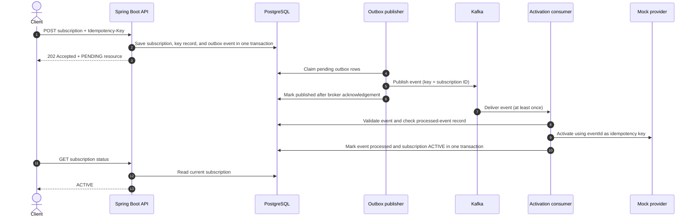

# Telecom Service Provisioning

> A portfolio-ready MVP that demonstrates how a subscription request can move
> reliably through a REST API, PostgreSQL, a transactional outbox, Kafka, and an
> idempotent telecom-provider boundary.


> **Demo scope:** the telecom provider is a local in-memory mock. `ACTIVE` means the
> mock accepted the request; it does **not** mean a real carrier activated a service.
> This repository is a local/demo MVP, not a production deployment.

## What this project demonstrates

A client requests a telecom package subscription. The service validates and stores the
request, then processes activation asynchronously. The design focuses on backend
engineering concerns that are useful to understand in a real provisioning workflow:

- Safe request retries through an idempotency key.
- Consistent database writes using PostgreSQL transactions.
- Reliable event publication using the transactional outbox pattern.
- At-least-once Kafka delivery with idempotent event processing.
- Bounded consumer retries and a dead-letter topic (DLT).
- Integration tests against real PostgreSQL and Kafka containers.

## See it run

### Prerequisites

- JDK 25
- Docker Desktop with Linux containers and Docker Compose

### Start the complete demo

Run these commands from the repository root in PowerShell:

```powershell
$env:POSTGRES_PASSWORD = Read-Host "Local PostgreSQL password"
docker compose up -d --build
docker compose ps
```

Wait until `postgres`, `kafka`, and `app` report healthy. The demo exposes its ports on
`127.0.0.1` only. Spring Security generates a local `user` password at startup; retrieve
it with:

```powershell
docker compose logs --tail 100 app
```

The local API requires authentication, and state-changing requests require CSRF
protection. Follow the [end-to-end PowerShell demo](docs/local-development.md) to seed a
synthetic package, create a subscription, and poll its status.

### Expected outcome

The demo creates a subscription with `202 Accepted` and an initial `PENDING` status.
PostgreSQL stores the request and its outbox event together. The outbox publisher sends
the event to Kafka; the consumer passes it through the mock provider and records the
completed event. The status then becomes `ACTIVE`.

```text
POST /api/subscriptions  ->  202 Accepted, PENDING
                                  |
                         PostgreSQL outbox
                                  |
                         Kafka event topic
                                  |
                     In-memory mock provider
                                  |
GET /api/subscriptions/{id}  ->  ACTIVE
```

This result demonstrates the local workflow only. No external carrier or telecom network
is called.

### Stop the demo

```powershell
docker compose down
```

This preserves the named PostgreSQL and Kafka data volumes. To remove local demo data as
well, use `docker compose down --volumes` only when you intentionally want to delete it.

## How the workflow is built



### Important design choices

1. **Idempotent HTTP requests:** the same idempotency key and payload return the original
   subscription. Reusing the key with a different payload returns `409 Conflict`.
2. **Transactional outbox:** the subscription, idempotency record, and event are saved in
   one PostgreSQL transaction. Kafka is not part of that transaction; the publisher
   retries persisted events and uses expiring database claims to coordinate publishers.
3. **At-least-once messaging:** a crash after Kafka accepts an event but before the
   publisher records success can cause redelivery. Consumers use `eventId` and a database
   processed-event record to make the local state transition idempotent.
4. **Provider boundary:** activation is called through an application port, outside the
   database transaction. The local adapter is an in-memory mock. A future real provider
   must support durable idempotency using the event ID.
5. **Failure handling:** consumer failures receive bounded retries; exhausted records
   are routed to the activation dead-letter topic with diagnostic headers.

See [event contracts](docs/event-contracts.md) and
[transaction and concurrency notes](docs/transaction-and-concurrency.md) for details.

## Technology stack

| Area | Technology |
|---|---|
| Language / runtime | Java 25 |
| Application framework | Spring Boot 4.1 |
| HTTP API and validation | Spring MVC, Jakarta Bean Validation |
| Authentication baseline | Spring Security defaults for the local demo |
| Persistence and schema | Spring Data JPA, PostgreSQL 18, Flyway |
| Asynchronous messaging | Apache Kafka 4.1, Spring Kafka |
| Reliability | Transactional outbox, database leases, idempotency, retries, DLT |
| Testing | JUnit, H2, Testcontainers for PostgreSQL and Kafka |
| Local environment | Docker Compose; multi-stage, non-root application image |
| CI | GitHub Actions running Maven verification |

## API at a glance

| Method | Endpoint | Purpose |
|---|---|---|
| `GET` | `/api/service-packages` | List active packages |
| `POST` | `/api/subscriptions` | Request a subscription; requires `Idempotency-Key` |
| `GET` | `/api/subscriptions/{id}` | Read the current subscription status |
| `GET` | `/actuator/health` | Read a minimal health status |

All API endpoints require authentication. The local demo uses Spring Security's generated
development user; POST requests also require CSRF protection. This is not a production
identity or API security policy. See the [API specification](docs/api-spec.md).

## Verify it

Fast application tests use H2:

```powershell
.\mvnw.cmd test
```

The integration profile starts PostgreSQL and Kafka with Testcontainers and verifies the
real database/broker workflow:

```powershell
.\mvnw.cmd -Pintegration-tests verify
```

The verified suite covers API validation, idempotency conflicts and concurrent requests,
outbox publication and recovery, PostgreSQL publisher claims, duplicate Kafka delivery,
consumer retry, and DLT routing. Container tests validate a single-broker local setup;
they do not prove production availability or multi-broker failover.

## Project map

```text
src/main/java/.../provisioning/
  api/                 REST controllers and request/response models
  application/         use cases and telecom provider port
  domain/              subscription and package rules
  infrastructure/      PostgreSQL and mock provider adapters
  messaging/           outbox, Kafka consumer, retries, and DLT
src/main/resources/
  db/migration/        versioned Flyway migrations
docs/                  API, architecture, testing, security, and demo guides
compose.yaml           local app, PostgreSQL, and Kafka
Dockerfile             multi-stage application image
```

## Current maturity and next steps

**MVP assessment:** suitable as a learning and portfolio demo for a junior backend
developer. It shows a complete local request-to-status flow, persistence, asynchronous
messaging, failure handling, container integration tests, and documented trade-offs. It
is not a certification of production readiness or a substitute for review against a
specific employer's requirements.

| Included in this MVP | Not implemented / not proven |
|---|---|
| Subscription API, status, validation, and request idempotency | Real carrier or network activation |
| PostgreSQL persistence, Flyway migrations, and transactional outbox | Durable idempotency in an external provider |
| Kafka consumer, duplicate protection, bounded retry, and DLT | Multi-broker failover or multi-process crash testing |
| Local mock provider and Docker Compose demo | Production identity, authorization policy, Kafka/database TLS |
| H2 application tests and PostgreSQL/Kafka Testcontainers | Production secrets management, dashboards, alerting, and operations |

Local Compose uses development credentials/settings and a single Kafka broker; its ports
bind to loopback. Before a shared or production deployment, select a real provider and
durable idempotency contract, identity provider, secrets manager, TLS/authentication
configuration, monitoring target, and deployment architecture.

## Further reading

- [Local development and complete demo instructions](docs/local-development.md)
- [Architecture and project structure](docs/architecture.md)
- [REST API specification](docs/api-spec.md)
- [Event contracts, retries, and DLT](docs/event-contracts.md)
- [Database design](docs/database-design.md)
- [Testing strategy and coverage boundaries](docs/testing-strategy.md)
- [Security and observability status](docs/observability-security.md)
- [MVP requirements](docs/requirements.md)
- [Implementation plan](docs/implementation-plan.md)
